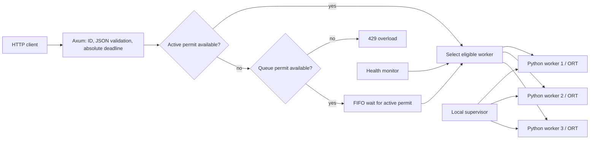

# InferCore

A software-only inference-serving MVP: Rust/Tokio/Axum gateway, three isolated
Python/ONNX Runtime CPU worker processes, bounded admission, two routing policies,
and tested failure recovery. Designed to learn serving systems in one focused week.

**Scope:** one Mac, one gateway, multiple worker processes. This exercises partial
failures and concurrency over HTTP; it is not a replicated multi-machine system.
No Kubernetes, Redis, database, authentication, GPU work, batching, or dashboard.

## Run locally

Verified on an Apple M1 (8 logical CPUs, 8 GiB), macOS 26.6.2, Python 3.10.14,
Rust 1.91.1. See `docs/VERIFICATION.md` for actual checks and limitations.

```sh
# Install Python 3.10 and Rust via rustup if absent.
# This repository pins Rust in rust-toolchain.toml.
python3 -m venv .venv
.venv/bin/python -m pip install -r requirements.lock
# Regenerates the bundled trained model and its metadata, no remote model download.
.venv/bin/python -m worker.model
cargo build --release --locked
.venv/bin/python scripts/local.py --policy round-robin
# In another run: --policy least-in-flight
```

On the original development Mac Rust was installed only into ignored `.tools/`.
Run `source scripts/env.sh` before Cargo commands there. On a fresh clone with
normal rustup installation, use Cargo directly; do not source that helper.
A project-local toolchain can be installed with:

```sh
mkdir -p .tools
curl --proto '=https' --tlsv1.2 -sSf https://sh.rustup.rs -o .tools/rustup-init.sh
CARGO_HOME="$PWD/.tools/cargo" RUSTUP_HOME="$PWD/.tools/rustup" \
  sh .tools/rustup-init.sh -y --no-modify-path --profile minimal --default-toolchain 1.91.1
source scripts/env.sh
rustup component add rustfmt clippy
```

The launcher binds gateway port 8080 and worker ports 9001–9003 on loopback.
It prints child PIDs, restarts terminated workers, and stops its children on Ctrl-C.
Use `--workers 1` through `--workers 16` to experiment; adjust gateway limits via
environment if needed. The verified default and benchmark configuration use three.
The launcher assumes these ports are free. Run one demo/benchmark/launcher at a time.

For just the gateway with a **simulated 25 ms async sleep**, not inference:

```sh
BACKEND=simulated cargo run --locked
```

## API

```sh
curl -i http://127.0.0.1:8080/health
curl -i http://127.0.0.1:8080/ready
curl -i http://127.0.0.1:8080/infer \
  -H 'Content-Type: application/json' \
  -d '{"values":[6.7,3.0,5.2,2.3],"deadline_ms":1000}'
```

`POST /infer` accepts exactly four finite numbers, each in [-1000,1000]; input
order is **sepal length, sepal width, petal length, petal width**, all centimetres.
`deadline_ms` defaults to 1000; accepted range 1–10000. Unknown fields are rejected.
The broad numerical bounds protect the runtime; they do not validate biological
plausibility. JSON bodies are limited to 4096 bytes.

Success is `{"request_id":"<uuid>","backend":"onnx","worker_id":0,"output":[p0,p1]}`.
`output` is `[P(versicolor), P(virginica)]`. Setosa was excluded from training.
In simulated mode the output is a one-element sum, explicitly labeled `simulated`.
Every HTTP response has a server-generated `x-request-id`; client IDs are ignored.
Errors carry a JSON `error` and the request ID in the response header.

| Status | Meaning |
| --- | --- |
| 200 | Successful inference, liveness, or ready |
| 400 | Invalid/oversize JSON, invalid features or deadline |
| 429 | Admission full; `Retry-After: 1` is a conservative hint |
| 503 | No eligible healthy worker, or two failed backend attempts |
| 504 | Original request deadline exhausted |

`GET /health` is liveness and bypasses inference admission. `GET /ready` reports
worker health and gateway-observed in-flight counts; returns 503 when none are
healthy. These counts are not proof that a timed-out native computation stopped.
The private worker API is HTTP `/health` and `/infer`; the latter also receives a
server-generated `request_id` and a remaining attempt budget in milliseconds.

## Request flow and capacity



Defaults: **6 active gateway requests + 12 FIFO waiters**. A pair of Tokio
semaphores bounds the work and the waiting futures. This is a bounded in-memory
request queue, not a durable channel. Request bodies are validated before
admission, so connection handling and JSON parsing are outside this bound.

Each worker accepts at most two pending jobs, including one computing. An async
lock serializes its ONNX calls; there is one intra-op and one inter-op ORT thread.
Six active gateway requests can therefore include three computing and three
waiting at workers. Depth two lets routing observe unequal in-flight counts; a
simpler depth-one worker avoids this second queue. Extra buffering absorbs bursts
but increases tail latency. Increasing a queue does not increase CPU capacity.

## Design choices and alternatives

- **Ownership and cleanup:** `AppState` clones `Arc` handles, not entire pools.
  `Arc` supplies shared lifetime, not mutation safety. Semaphores own admission;
  a mutex protects the tiny pool metadata. A `Lease` owns a worker count and
  decrements on `Drop`. This RAII pattern avoids missing a decrement in an error
  branch. No blocking mutex spans an `.await`.
- **Async concurrency:** a future yields while waiting for HTTP, a permit, or a
  timer. Tokio can then run another request. It does not accelerate the ONNX CPU
  math. Directly executing blocking inference in an Axum handler would occupy its
  executor. An in-process blocking thread pool is a simpler alternative but shares
  the gateway's memory and crash fate.
- **Process isolation:** each worker has its own Python interpreter and ONNX
  session. Crashes are independent; weights and runtime overhead are duplicated.
  Standard HTTP/JSON makes debugging easy at the expense of serialization and
  loopback latency. This is not a security sandbox.
- **Routing:** round-robin rotates through healthy workers below depth two.
  Least-in-flight chooses the smallest outstanding count, using rotating ties.
  Selection and increment happen under one lock, preventing concurrent selection
  from repeatedly seeing the same stale count. Counts measure outstanding work,
  not CPU cost; both policies can be similar for identical workers and tiny jobs.
- **Backpressure:** immediate 429 prevents unlimited waiting. Clients must slow
  down or retry with bounded backoff/jitter; an unbounded retry loop amplifies
  overload. A FIFO semaphore queue is sufficient here; a central dispatcher would
  make priorities possible but adds task lifecycle and cancellation complexity.
- **Deadlines:** one monotonic timestamp starts at HTTP middleware entry. Parsing,
  queue wait, worker selection, transport and retry share that budget. The first
  attempt gets half the remaining time; a second different worker gets what is
  left. This reserves retry time but can reject a slow healthy worker too early.
  Slow request-body reads additionally have a fixed 10-second server cap, since
  the JSON client deadline cannot be known before parsing.
- **Cancellation:** dropping Rust futures releases gateway permits and leases.
  It does not forcibly interrupt remote/native work. Workers shield their tracked
  compute task so a cancelled HTTP coroutine cannot release the compute lock
  while its native thread continues. Expired work waiting at a worker is skipped;
  running ORT is allowed to finish. Killing a process would stop work but also
  destroys its model session and unrelated admitted jobs.
- **Retries:** at most two attempts, different workers only, within the original
  deadline. Transport errors, non-2xx, invalid output, and attempt timeout exclude
  that worker. Inference is pure, so repeated calculation has no state side
  effects; it still costs CPU. There is no exactly-once guarantee or deduplication.
  Retrying a state-changing API would need a different design.
- **Health and recovery:** concurrent probes run roughly every 250 ms, with
  150 ms probe timeouts. Failed inference excludes immediately; successful later
  probes allow re-entry. Epoch checks prevent a probe started before a failure
  from accidentally undoing it. The Python launcher restarts crashed workers;
  Rust discovers recovery over HTTP. The gateway does not own worker processes.

For the underlying APIs see [Axum](https://docs.rs/axum/latest/axum/),
[Tokio semaphores](https://docs.rs/tokio/latest/tokio/sync/struct.Semaphore.html),
[ORT Python](https://onnxruntime.ai/docs/api/python/api_summary.html), and
[ORT threading](https://onnxruntime.ai/docs/performance/tune-performance/threading.html).

## Model provenance

`worker/model.py` trains binary logistic regression on the bundled scikit-learn
Iris dataset, using a fixed stratified 80/20 split and seed 2026, then exports
standard MatMul/Add/Sigmoid/Sub/Concat operations (opset 17, IR 9). No separate
converter, external weights, model hosting service, or training framework is
required. `models/iris_logistic.json` records the SHA-256 and held-out accuracy.
The checked-in ONNX artifact is only a few hundred bytes. This is a real trained
classifier but intentionally not a demanding or novel AI model. Small held-out
accuracy is not evidence of generalization to arbitrary flowers or input ranges.
Tests regenerate byte-identical ONNX and compare all 20 held-out predictions with
scikit-learn within an absolute tolerance of 2e-6.

## Tests, demo and benchmarks

```sh
cargo test --locked
cargo fmt --check
cargo clippy --all-targets --locked -- -D warnings
cargo build --release --locked
.venv/bin/python -m pytest -q tests/test_system.py
# Runs the local supervisor, sends simultaneous requests, kills a worker,
# records the new PID and successful routing after recovery, then cleans up.
.venv/bin/python scripts/demo.py
# Preserves raw request JSONL plus metadata and per-run summaries.
.venv/bin/python scripts/benchmark.py --output benchmarks/my-run
```

The benchmark starts its own three workers and gateway. It uses 1 second warmup,
5 second measurements, concurrency 1/12/48, and three repeats per policy, reversing
policy order on alternating repeats. `--seconds 30 --warmup 5` gives longer runs.
It is closed-loop: each client sends its next request after the previous response.
This cannot establish capacity under an independent external arrival rate and
suffers coordinated omission during stalls. The load generator shares the Mac's
CPU. The model is tiny; overhead dominates. Do not generalize to LLM serving.

Percentiles use nearest rank. p95 means 95% of successful requests completed no
slower than that time; p99 exposes rarer delays and needs enough samples. Report
success throughput, success percentiles, rejection count, and other errors
together. The raw files also retain latency for every failed/rejected request;
histograms in summary JSON are cumulative and are not an additional measurement.
See [recorded results](docs/BENCHMARKS.md) and [verification](docs/VERIFICATION.md).

## Docker (optional)

Docker isolates runtime dependencies and makes the three-process deployment
repeatable. Native execution is preferable for understanding and measuring this
Mac; Docker Desktop uses a Linux VM, so its benchmarks are a different environment.

```sh
docker compose up --build
# Switch policy:
POLICY=least-in-flight docker compose up --build
# In a separate terminal: simulate worker failure, then restore it.
docker compose kill worker1
docker compose up -d worker1
```

Image version tags and package lockfiles are pinned, not immutable image digests.
Dockerfiles/Compose are supplied; the development daemon was unavailable, so
container execution is **not verified**. Compose syntax validation is recorded.

## Configuration and failure boundaries

| Variable | Default | Purpose |
| --- | --- | --- |
| BACKEND | simulated | Explicit simulated or onnx mode |
| BIND | 127.0.0.1:8080 | Gateway listen address |
| WORKER_URLS | localhost ports 9001–9003 | Comma-separated HTTP endpoints |
| POLICY | round-robin | Or least-in-flight |
| MAX_IN_FLIGHT | 6 | Active requests; must be positive |
| QUEUE_CAPACITY | 12 | Waiting requests; zero disables waiting |

A dead worker causes temporary errors/retries, followed by exclusion and recovery.
All workers down: `/health` stays 200; `/ready` and inference return 503. A busy
worker can return 429 and be excluded until a later successful health probe; this
simple policy can flap under overload. Gateway timeout frees gateway capacity,
while worker-side bounded admission protects against lingering native work.
Health is process/session liveness, not a guarantee of progress of every model call.
There is no dedicated circuit-breaker cooldown, process memory limit, persistent
queue, durable result store, automatic gateway restart, or gateway redundancy.

The global admission limit does not bound idle connections, slow clients, parsing
before admission, or all network buffers. For internet exposure one would need
connection/read-rate limits, authentication and TLS; this project binds locally.
The supervisor retries a crashed worker every 250 ms without exponential backoff;
a persistent startup error requires operator correction. Graceful shutdown waits
for current work; the launcher force-kills after five seconds if necessary.

Scaling next requires measurement: CPU saturation, HTTP overhead, model memory,
per-worker queueing, and client bottlenecks. A larger trained model or controlled
heterogeneous service times would better distinguish scheduling policies. Multiple
hosts would introduce network partitions and service discovery; multiple gateways
would lose globally consistent counters. Replication, consensus and durable data
are separate learning projects, not implemented here.

## Learning and resume use

Read [the seven-day guide](docs/LEARNING.md) for code walk-throughs, experiments,
and questions to answer yourself. [Career fit](docs/CAREER_FIT.md) explains what
this adds to the existing resume and provides evidence-based project bullets.
The chronological [build log](docs/BUILD_LOG.md) records the simulated-first step.
